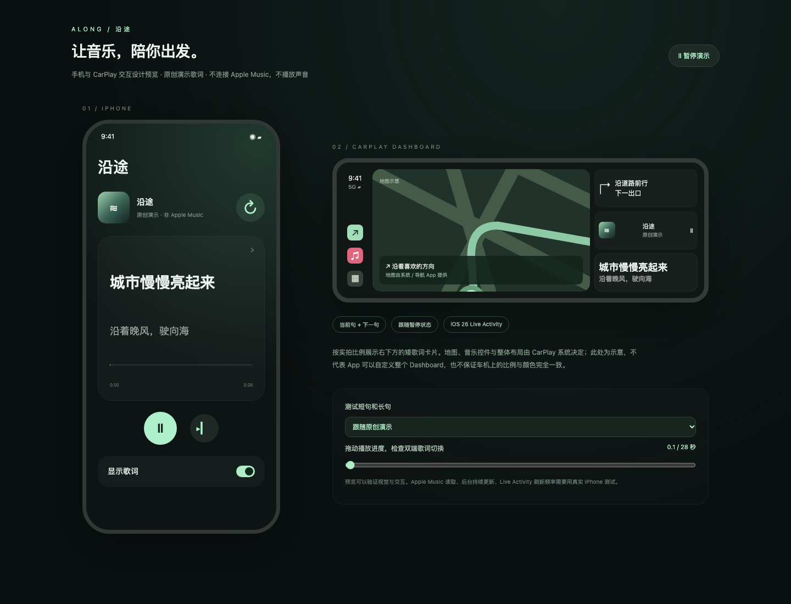

# 沿途 Along · CarPlayLyrics

一个个人维护、免费开源的 iOS 歌词伴侣：跟随 Apple Music 或 Spotify 播放，在手机、锁屏与兼容的 CarPlay Dashboard 上显示当前句和下一句。

> **基于 [Praveet Gupta 的 DriveVerse](https://github.com/praveetgupta/driveverse) 改造，感谢原作者。** 基础版本：[d2ecd418f85883a94881d3d810d00ee1f830ab22](https://github.com/praveetgupta/driveverse/commit/d2ecd418f85883a94881d3d810d00ee1f830ab22)。本仓库独立发布修改后的源码快照，未导入上游 Git 历史，并非从零原创。代码沿用 MIT 许可证，原作者版权声明保留在 [LICENSE](LICENSE)。完整来源见 [致谢](NOTICE.md)。

**状态：实验性源码项目，需自行用 Xcode 安装；未在 App Store 发布，未获得 Apple / Spotify 官方认可。** 当前后台同步使用定位会话，尚不适合作为可直接上架的发行版本。代码开源不代表歌词内容已获授权；免费与个人用途也不自动豁免第三方权利或服务条款。发布或再分发前请阅读 [内容与分发限制](docs/DISTRIBUTION.md)。

## 界面预览



这是 HTML 设计示意，使用原创示例文字，不是真机截图。地图、音乐控件和 Dashboard 排版由系统决定，实际显示可能不同。下载后打开 [preview/index.html](preview/index.html) 可交互预览。

## 功能

- 手机显示当前句和下一句，点击歌词框查看完整歌词；播放 / 暂停、下一首、手动刷新。
- Live Activity 显示歌词，可在兼容设备的锁屏、灵动岛与 CarPlay Dashboard 出现。
- LRCLIB 歌词匹配：简繁互查、歌手别名、版本与时长检查、有限失败重试。
- 繁体中文歌词在显示时转为简体，中文使用系统苹方字体。
- Spotify 为实验性集成，需用户自己的开发者应用及账号授权。

不提取 Apple Music 内置歌词；Apple Music 有歌词并不意味着 LRCLIB 也有。无法保证覆盖、时间轴准确性、无限时后台同步或每种车机布局，也无法移除系统音乐卡片或提供全屏 CarPlay 歌词页。

## 安装

需要 macOS、支持 iOS 26 SDK 的完整 Xcode、iOS 26+ iPhone。CarPlay 功能还需要兼容的车机。

```sh
git clone https://github.com/thaddywu/CarPlayLyrics.git
cd CarPlayLyrics
open DriveVerse.xcodeproj
```

1. 选择 `DriveVerse` scheme。为 `DriveVerse` 和 `DriveVerseWidgets` 两个 target 选择自己的签名 Team，开启自动签名。
2. 将两个 Bundle ID 改为自己的唯一标识，扩展 ID 使用主 App ID 的子标识；仓库中的标识只是默认值。
3. 连接 iPhone，按 Xcode 提示信任设备并开启开发者模式，按 **⌘R** 安装。
4. 授予媒体访问权限，在 Apple Music 播放歌曲。首页「显示歌词」默认关闭，手动开启后按需授予定位与 Live Activity 权限。
5. 连接 CarPlay，在 Dashboard 查看；布局和是否显示由系统决定。请在停车时测试与操作。

Apple Music 播放状态通过系统 MediaPlayer 读取，不需要提供账号密码或 MusicKit token。无需复制 `Secrets.plist`，Spotify Client ID 可以直接在设置中输入。

### Spotify（实验性，未确认公开发行合规性）

除配额外，跨服务歌词同步、来源署名与回链等平台要求仍需核实，详见 [分发限制](docs/DISTRIBUTION.md)。以下配置步骤不代表平台已批准该用途。

在 [Spotify Developer Dashboard](https://developer.spotify.com/dashboard) 创建自己的开发者应用，按平台要求配置账号 / 测试用户，将 Redirect URI 登记为：

```text
com.thaddywu.along.spotify://callback
```

在沿途设置中填写 **Client ID**，然后连接授权；不需要 Client Secret。更改 URL scheme 时，需同步修改 `SpotifyAuth.redirectURI`、Info.plist 和开发者后台。开发模式有账号资格、用户数量和配额限制，不能将一个开发凭据当作公开用户接入方案。详见 [Spotify quota modes](https://developer.spotify.com/documentation/web-api/concepts/quota-modes)。

真实 Spotify 授权、播放控制与后台同步仍需设备验证，不能仅凭单元测试确认可用。

## 隐私、权利与反馈

- [隐私与数据流](PRIVACY.md)：说明查询元数据、外部服务、缓存、Spotify token 与定位用途。
- [许可证与上游致谢](NOTICE.md)：MIT 覆盖代码，不授予歌词、录音、封面或第三方商标权利。
- [内容与分发限制](docs/DISTRIBUTION.md)：当前实现的已知限制；免责声明不能代替授权或平台许可。
- 问题与权利反馈：[GitHub Issues](https://github.com/thaddywu/CarPlayLyrics/issues)。请不要上传完整歌词、私人截图、token、密码或其他敏感资料；权利反馈可先提供受影响的文件路径及权利说明，敏感材料不要公开。

本仓库不提供音频、商业歌曲歌词库、预置账号凭据或可直接分发的安装包。不代表 Apple、Spotify、LRCLIB 或上游作者对本改版提供支持或背书。

## 开发与验证

```sh
bash scripts/test.sh
```

使用 SwiftPM 在 macOS 测试核心逻辑；iOS App 与 Widget 需用 Xcode 构建。如需从 `project.yml` 重新生成工程，安装 XcodeGen 后运行 `bash scripts/generate.sh`，并重新选择自己的签名配置。

公开前本地验证结果见 [发布检查](docs/RELEASE_CHECK.md)。实现细节、测试边界与历史排查见 [开发记录](docs/DEVELOPMENT.md)，歌手对应表见 [ARTIST_ALIASES](docs/ARTIST_ALIASES.md)。
